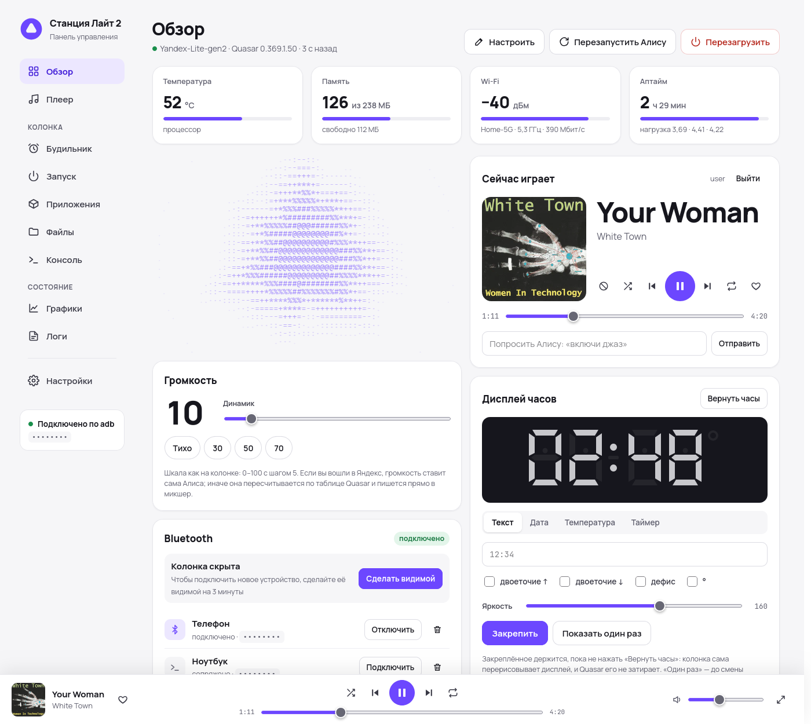
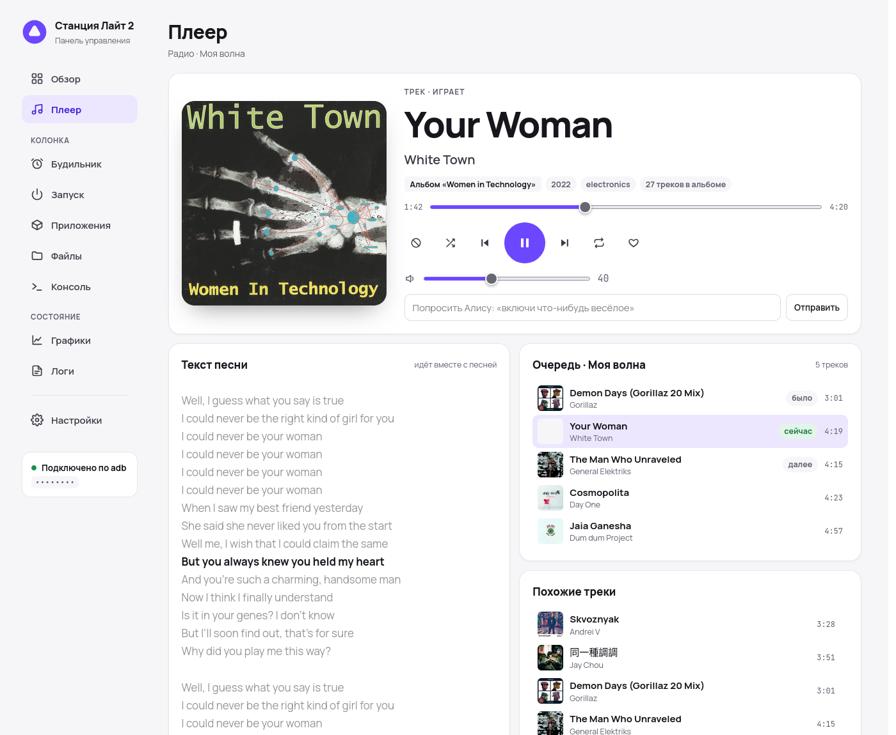
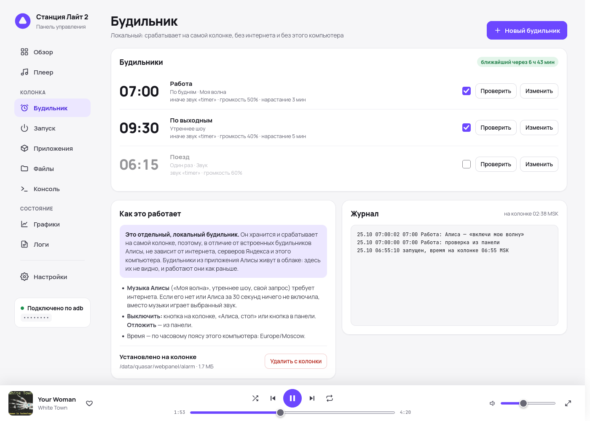
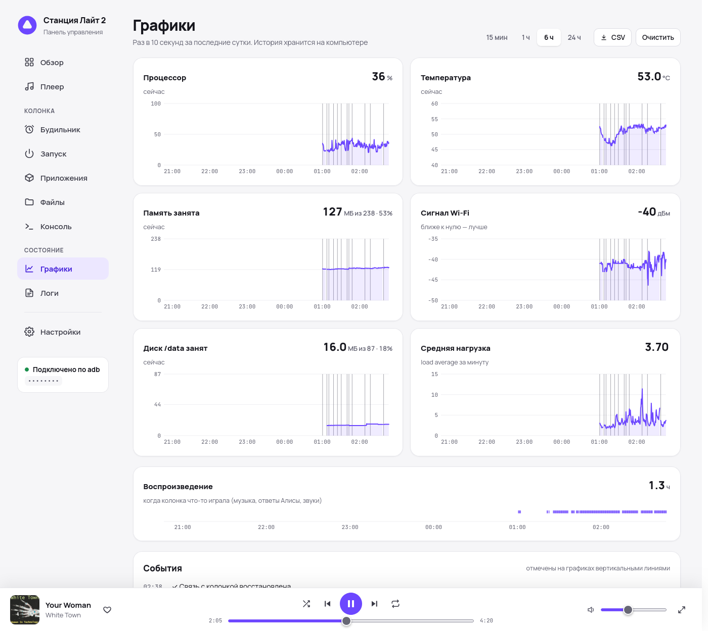
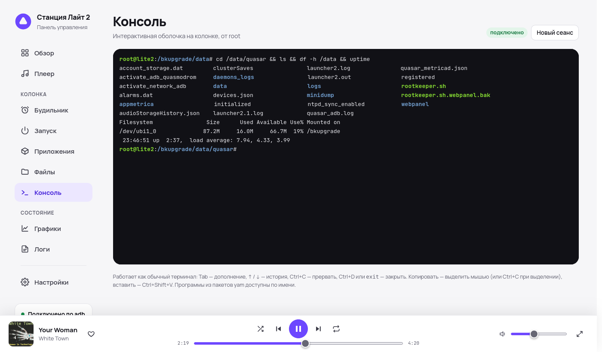
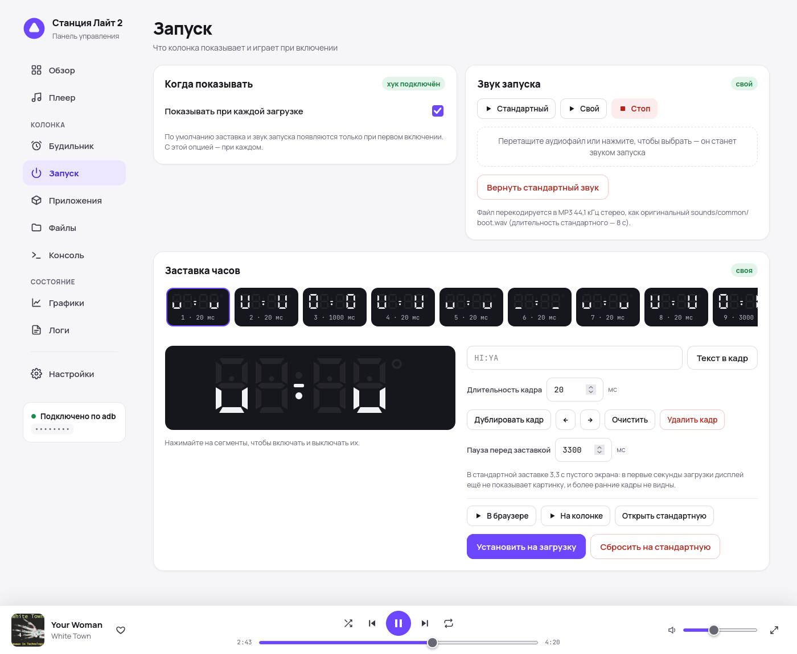
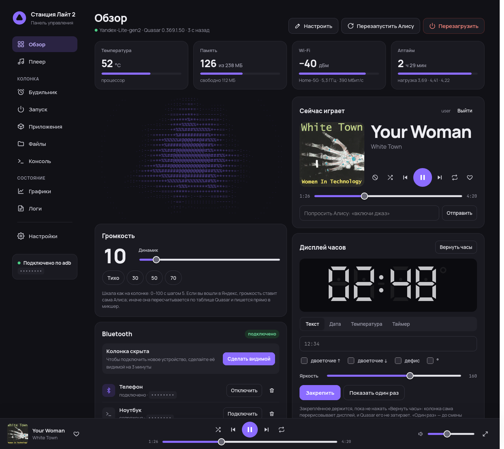

# Веб-панель для Яндекс Станции Лайт 2

Локальная веб-панель для **Яндекс Станции Лайт 2 с root-доступом по adb**: музыка и плеер, будильник, который
работает без интернета, своя заставка и звук запуска, подсветка и дисплей часов, Bluetooth, графики, файлы,
логи и интерактивная root-консоль. Всё работает в локальной сети, через adb и локальный протокол колонки.
Отдельно ставить на колонку ничего не нужно.

> [!WARNING]
> Неофициальный проект, не связан с Яндексом. Панель работает только на колонке, где уже есть root-доступ по adb,
> и сама колонку не рутирует. Консоль, файлы и некоторые функции дают полный доступ к системе колонки:
> используйте на свой риск.



<table>
  <tr>
    <td></td>
    <td></td>
  </tr>
  <tr>
    <td align="center">Плеер: текст песни, очередь, похожие треки</td>
    <td align="center">Локальный будильник</td>
  </tr>
  <tr>
    <td></td>
    <td></td>
  </tr>
  <tr>
    <td align="center">Графики за сутки</td>
    <td align="center">Интерактивная root-консоль</td>
  </tr>
  <tr>
    <td></td>
    <td></td>
  </tr>
  <tr>
    <td align="center">Редактор заставки и звук запуска</td>
    <td align="center">Тёмная тема</td>
  </tr>
</table>

## Возможности

**Каждый день**
- **Обзор** — температура, память, Wi‑Fi, аптайм; 3D-модель колонки в цвете корпуса, на которой в реальном времени
  повторяются дисплей часов и кольцо; громкость, звуки колонки и свои файлы, подсветка, дисплей часов (текст, дата,
  температура, таймер). Виджеты можно переставлять и прятать.
- **Плеер** — что играет, управление, громкость, команды Алисе, текст песни с подсветкой текущей строки
  (Яндекс Музыка или [LRCLIB](https://lrclib.net)), очередь, похожие треки, об исполнителе, ссылки на Яндекс Музыку.
  Вход в Яндекс — по QR-коду. Музыку с телефона по Bluetooth плеер тоже показывает.
- **Будильник** — работает на самой колонке, даже когда компьютер с панелью выключен. «Моя волна», утреннее шоу,
  любой запрос Алисе или свой звук; если нет интернета — играет звук. Нарастание громкости, «отложить»,
  выключение кнопкой на колонке или голосом.

**Колонка**
- **Запуск** — своя заставка на дисплее часов (покадровый редактор) и свой звук включения.
- **Приложения** — установка пакетов [yam](https://github.com/nyakokitsu/yam) из реестра
  [yapkg](https://github.com/nyakokitsu/yapkg).
- **Файлы** — просмотр, правка, загрузка и скачивание, проигрывание аудио прямо с колонки.
- **Консоль** — настоящий терминал (xterm.js): Tab, история, Ctrl+C, `top`, `vi`.
- **Bluetooth** — сопряжённые устройства, подключение и «забыть», видимость на 3 минуты.

**Состояние**
- **Графики** — процессор, температура, память, диск, Wi‑Fi, нагрузка и воспроизведение за сутки, события
  (перезагрузки, обрывы связи, будильники), выгрузка в CSV.
- **Логи** — логи демонов Quasar и dmesg с фильтром.

**Панель**
- Пароль, HTTPS со своим сертификатом, установка как приложение (PWA), светлая и тёмная тема, цвет акцента.
- Резервная копия всего, что панель поставила на колонку, и полное удаление в один клик.

## Что нужно

- Яндекс Станция Лайт 2 с **root-доступом по adb** — по сети (`adb connect <IP>:5555`) или по USB.
- Компьютер или сервер в той же сети:
  - **Python 3.9+** (только стандартная библиотека) и **adb** ([Android platform-tools](https://developer.android.com/tools/releases/platform-tools));
  - по желанию **ffmpeg** — чтобы играть mp3/ogg/opus и менять звуки (без него — только WAV) и **openssl** — для HTTPS;
  - или **Docker** — там всё уже есть.

## Установка

### Windows — запускать, когда нужно

1. Установите [Python](https://www.python.org/downloads/) и отметьте «Add python.exe to PATH».
2. Скачайте проект: **Code → Download ZIP** (или со страницы релизов) и распакуйте.
3. Скачайте [platform-tools для Windows](https://dl.google.com/android/repository/platform-tools-latest-windows.zip)
   и положите папку `platform-tools` рядом с `server.py` (или добавьте её в `PATH`).
4. По желанию: `winget install Gyan.FFmpeg` — для mp3/ogg и своих звуков.
5. Запустите **`start.bat`**. При первом запуске он спросит IP колонки, запомнит его и откроет панель в браузере.

### Linux / macOS — запускать, когда нужно

```sh
# Debian/Ubuntu: sudo apt install python3 adb ffmpeg      Fedora: sudo dnf install python3 android-tools ffmpeg
# macOS:        brew install python android-platform-tools ffmpeg
git clone https://github.com/dimap/yandex-lite2-web.git
cd yandex-lite2-web
./start.sh 192.168.1.50     # IP колонки; дальше можно просто ./start.sh
```

Панель откроется на `http://127.0.0.1:8765/`. Остановить — Ctrl+C.

### Docker — постоянно на сервере

```sh
git clone https://github.com/dimap/yandex-lite2-web.git
cd yandex-lite2-web
# в docker-compose.yml укажите IP колонки в ADB_SERIAL
docker compose up -d
```

Панель: `http://<адрес сервера>:8765/`. Всё своё (вход в Яндекс, пароль, сертификаты, история графиков,
ключ adb) хранится в `./data`. Образ собирается для amd64, arm64 и armv7 (Raspberry Pi) и публикуется в
`ghcr.io/dimap/yandex-lite2-web`; собрать самому — раскомментируйте `build: .` в `docker-compose.yml`.

> В Docker панель открыта для всей локальной сети — **задайте пароль** во вкладке «Настройки» → «Доступ».

## Параметры

| Аргумент | Переменная | По умолчанию | |
|---|---|---|---|
| `--device` | `ADB_SERIAL` | запомненный | IP колонки (порт 5555 подставится сам), `host:port` или серийник USB |
| `--host` | `PANEL_HOST` | `127.0.0.1` | `0.0.0.0` — доступ из локальной сети (в Docker так и есть) |
| `--port` | `PANEL_PORT` | `8765` | порт HTTP |
| `--https-port` | `PANEL_HTTPS_PORT` | `8766` | порт HTTPS, `0` — выключить |
| `--data-dir` | `PANEL_DATA_DIR` | рядом с `server.py` | где хранить токен, пароль, сертификаты, историю |
| `--open` | | | открыть панель в браузере |
| | `ADB` | из `PATH` | путь к adb |

## Безопасность

- По умолчанию панель слушает только `127.0.0.1`. Если открываете её в сеть (`--host 0.0.0.0`, Docker) — задайте пароль.
- Пароль хранится только как PBKDF2-хэш; вход — cookie на 90 дней; после 5 ошибок — пауза. Забыли пароль —
  удалите `.panel_auth.json` в папке данных и перезапустите панель.
- Запросы и консоль с чужих сайтов отклоняются всегда (проверка `Origin`), даже без пароля.
- HTTPS: при первом запуске создаётся свой маленький центр сертификации. Он ограничен локальными адресами
  и именами, поэтому, даже установленный на телефон, для чужих сайтов не действует.
- Токен Яндекса хранится только на компьютере с панелью (`.yandex_auth.json`, права 600) и в браузер не попадает.
- У веб-интерфейса yamd (порт 8099 на колонке) своей авторизации нет — это свойство yam, а не панели.

## Что панель ставит на колонку

Только то, что вы включили сами, — всё в `/data/quasar/webpanel` плюс одна строка автозапуска в
`/data/quasar/rootkeeper.sh` (перед первой правкой сохраняется копия):

| Функция | Что на колонке |
|---|---|
| Своя заставка / звук запуска | файл + bind mount поверх стандартного (`/system` только для чтения) |
| «Показывать заставку при каждой загрузке», автозапуск yamd | файлы-флаги |
| Будильник | `alarm/`: скрипт-демон, конфиг, звуки, журнал |

Остальное работает через adb и ничего не оставляет (временное — в `/tmp`). Вкладка «Настройки» → «Колонка»
показывает, что установлено, делает резервную копию и одной кнопкой убирает всё, возвращая колонку к исходному
состоянию.

## Как это устроено

Один процесс на Python без зависимостей (`server.py`) и одна страница (`static/index.html`).
- С колонкой — через adb: `shell`, файлы — `pull`/`push` (`exec-out` этот adbd не умеет, а `shell` портит бинарные данные).
  Фоновые скрипты на колонке запускаются через `start-stop-daemon`, иначе их убивает adbd.
- Плеер и громкость — локальный протокол Glagol (WebSocket на порту 1961 колонки) с токеном вашего аккаунта;
  трек, текст, очередь — API Яндекс Музыки.
- Дисплей часов — sysfs `plum:white:clock*`; кольцо — framebuffer `/dev/fb0`, как у самой Алисы.
- Будильник — sh-демон `device/alarmd.sh`; запросы Алисе он отправляет сам через отладочный CLI `maind --cli`.
- Консоль — WebSocket `/api/term` ↔ `adb shell` (псевдотерминал выделяет adbd на колонке).

Проверялось на прошивке 0.369.1.50. На других версиях что-то может работать иначе — пишите в Issues.

## Благодарности и лицензии

Код панели — [MIT](LICENSE).

- 3D-модель колонки — [«Yandex Station Lite 2 | Яндекс станция лайт 2»](https://www.thingiverse.com/thing:7349611)
  от **vanyabeat**, лицензия [CC BY-SA 4.0](https://creativecommons.org/licenses/by-sa/4.0/). Файлы в `3d/`
  не изменены, подробнее — [3d/README.md](3d/README.md).
- [three.js](https://threejs.org) (MIT), [xterm.js](https://xtermjs.org) (MIT),
  [QR Code Generator](https://github.com/kazuhikoarase/qrcode-generator) Kazuhiko Arase (MIT) — в `static/vendor`.
- Тексты песен — [LRCLIB](https://lrclib.net); пакеты — [yam / yapkg](https://github.com/nyakokitsu/yam).
- Протокол Glagol и вход по QR — по мотивам [YandexStation](https://github.com/AlexxIT/YandexStation) для Home Assistant.

«Яндекс», «Алиса» и «Яндекс Станция» — товарные знаки ООО «Яндекс». Проект неофициальный.
